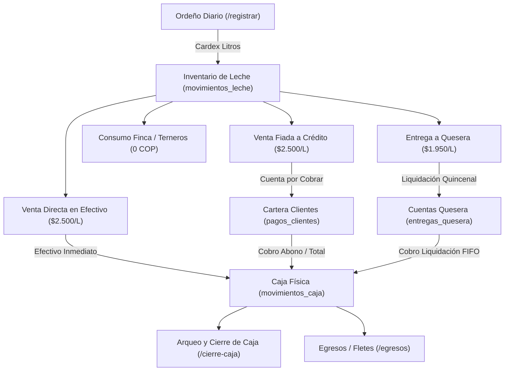

# 🥛 Sistema de Gestión de Lechería

Sistema integral para el control operativo, financiero y de volumen en fincas y lecherías cooperativas. Desarrollado con **React 19 + TypeScript + Vite + TailwindCSS** en el frontend y **Supabase (PostgreSQL + RLS + RPC Stored Procedures)** en el backend.

---

## 🏗️ Arquitectura y Flujos Conectados

El sistema une los 3 pilares clave del negocio lácteo bajo reglas de consistencia matemática estricta:



---

## 📦 Módulos del Sistema

| Módulo | Ruta | Rol Mínimo | Descripción |
|---|---|---|---|
| **Dashboard General** | `/` | Trabajador | KPIs en tiempo real: stock de leche, caja esperada, ventas del día, resumen de ordeños y accesos directos. |
| **Registrar Ordeño** | `/registrar` | Trabajador | Pesaje de leche por jornada (Mañana/Tarde). Restricción anti-duplicación por fecha y turno. |
| **Historial de Ordeños** | `/produccion` | Trabajador | Consulta de producción diaria, comparación mañana vs tarde y totales. |
| **Venta Directa** | `/venta-directa` | Trabajador | Venta en efectivo a $2.500/L con cálculo automático de stock disponible. |
| **Venta Fiada** | `/fiados` | Trabajador | Registro a crédito con selección rápida de clientes y creación de nuevos deudores en el acto. |
| **Consumo Finca** | `/consumo` | Trabajador | Salida de leche para autoconsumo o alimentación animal sin impacto en caja. |
| **Entrega a Quesera** | `/quesera` | Trabajador | Despacho de cantinas a precio de convenio ($1.950/L) acumuladas para cobro periódico. |
| **Cobro de Fiados** | `/cobrar-fiado` | Administrador | Abono o pago total de saldos de clientes con ingreso de efectivo a caja física. |
| **Liquidación Quesera** | `/liquidacion-quesera` | Administrador | Cobro quincenal de la quesera con modelo FIFO para marcar entregas saldadas. |
| **Egresos y Retiros** | `/egresos` | Administrador | Salidas de caja para pagos de transporte/flete o retiros de utilidad. |
| **Cierre de Caja** | `/cierre-caja` | Administrador | Arqueo físico contra caja esperada, cálculo de sobrante/faltante y retiro automático a base. |
| **Historial de Caja** | `/historial-caja` | Administrador | Libro diario de movimientos financieros con filtros por fecha y categoría. |
| **Estado de Clientes** | `/clientes` | Administrador | Detalle de deudas acumuladas, desglose de entregas y abonos históricos. |
| **Correcciones Trazables**| `/correcciones` | Administrador | Auditoría de ajustes con movimientos compensatorios automáticos sin borrar historial. |

---

## 🗄️ Base de Datos y Supabase

El archivo maestro consolidado se encuentra en [`bd/00_master_schema.sql`](bd/00_master_schema.sql).

### Instrucciones de despliegue en Supabase:
1. Abre el panel de tu proyecto en [Supabase](https://supabase.com).
2. Ve al **SQL Editor**.
3. Copia y ejecuta todo el contenido de [`bd/00_master_schema.sql`](bd/00_master_schema.sql).
4. El script configurará:
   - Tablas maestras (`profiles`, `producciones_leche`, `movimientos_leche`, `clientes`, `ventas_directas`, `entregas_quesera`, `movimientos_caja`, `pagos_clientes`, `pagos_quesera`, `cierres_caja`, `correcciones`).
   - Políticas RLS (Row Level Security) seguras para trabajadores y administradores.
   - Procedimientos almacenados transaccionales (RPCs) para cada operación.

---

## 🌐 Despliegue en Producción

**URL en vivo:** [https://lecheria-thn6.vercel.app/](https://lecheria-thn6.vercel.app/)

El proyecto está desplegado en **Vercel** conectado al branch `main` de GitHub. Cada push a `main` genera un redeploy automático.

### Variables de Entorno en Vercel

| Variable | Descripción |
|---|---|
| `VITE_SUPABASE_URL` | URL del proyecto Supabase |
| `VITE_SUPABASE_ANON_KEY` | Clave anónima (pública) de Supabase |

---

## 🚀 Ejecución en Desarrollo

```bash
cd frontend
npm install
npm run dev
```

El aplicativo estará disponible en `http://localhost:5173`.

---

## 📱 PWA (Progressive Web App)

La aplicación es instalable desde el navegador móvil como una app nativa:
1. Abre [https://lecheria-thn6.vercel.app/](https://lecheria-thn6.vercel.app/) en Chrome/Safari.
2. Toca **"Agregar a pantalla de inicio"** o **"Instalar"**.
3. La app se abrirá en modo pantalla completa sin barra de navegador.

---

## 👥 Roles del Sistema

| Rol | Acceso |
|---|---|
| **Trabajador** | Dashboard, Registrar Ordeño, Historial, Ventas, Fiados, Consumo, Quesera, Correcciones |
| **Administrador** | Todo lo anterior + Cobrar Fiados, Liquidación Quesera, Egresos, Cierre de Caja, Historial Caja, Estado de Clientes |
